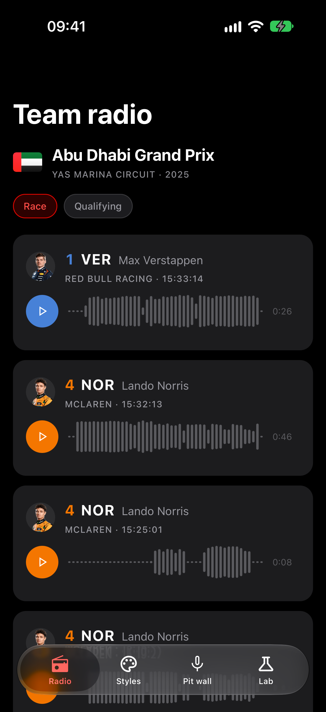
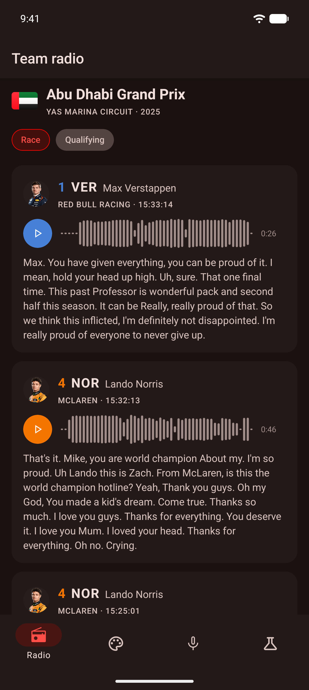

# expo-waveform

[](https://www.npmjs.com/package/@hzblj/expo-waveform)
[](./LICENSE)

Audio waveforms for Expo, drawn natively on iOS and Android: a file analysed on the device and cached, a playhead that follows the player at the display's frame rate, seeking by drag or tap with haptics, markers, and a live meter for recordings.

<p>
  
  
</p>

```sh
npx expo install @hzblj/expo-waveform
```

```tsx
import {useWaveformPlayback, WaveformView} from '@hzblj/expo-waveform'
import {useAudioPlayer} from 'expo-audio'

const player = useAudioPlayer(url)
const playback = useWaveformPlayback(player)

<WaveformView onSeek={time => player.seekTo(time)} playback={playback} source={url} style={{height: 40}} />
```

**[Documentation](./packages/expo-waveform/README.md)**: files and remote URLs, following playback, markers, live metering, analysis without a view, every prop, accessibility, and how the platforms differ.

## This repository

| Path | What lives there |
| --- | --- |
| `packages/expo-waveform/` | `@hzblj/expo-waveform`, the published package: the view, the hooks and the analysis API, the iOS and Android module |
| `apps/example/` | The example app, built from [Kara](https://github.com/hzblj/kara-ui): a Formula 1 weekend's team radio (captured from [OpenF1](https://openf1.org)) as waveforms, scrubbed word by word, a playground for every prop, a live meter of the microphone and of the radio, and the analysis on its own |

```sh
yarn                 # install
yarn prebuild        # a clean `expo prebuild` of the example
yarn ios             # run the example on iOS (dev client); `yarn android` for Android
yarn start           # Metro for the example
yarn test            # the JavaScript tests
yarn test:ios        # the Swift tests on the Mac, against audio they write
yarn test:android    # the Kotlin tests on the JVM (after a prebuild)
yarn lint            # Biome and TypeScript
yarn pack:check      # pack the package as npm gets it and type-check a consumer
yarn changeset       # describe a change for the next release
```

## More libraries

The other libraries from the same author are at **[libraries.janblazej.dev](https://www.libraries.janblazej.dev)**.

## Sponsorship

<a href="https://www.buymeacoffee.com/hzblj"></a>

## License

MIT © Jan Blazej. The example holds the weekend's names, times and links; the audio and photos stream from Formula 1 while it runs, and none of them are part of this repository.
